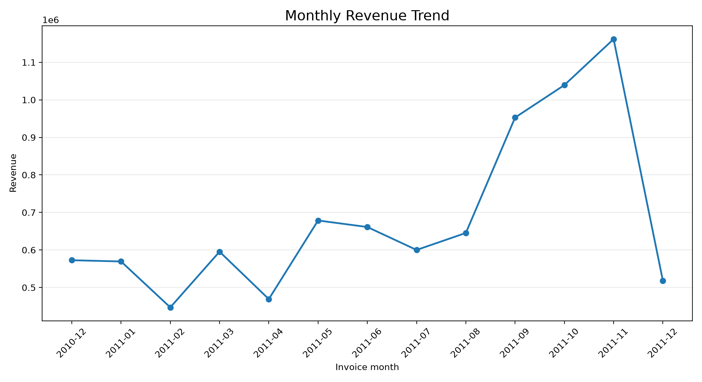
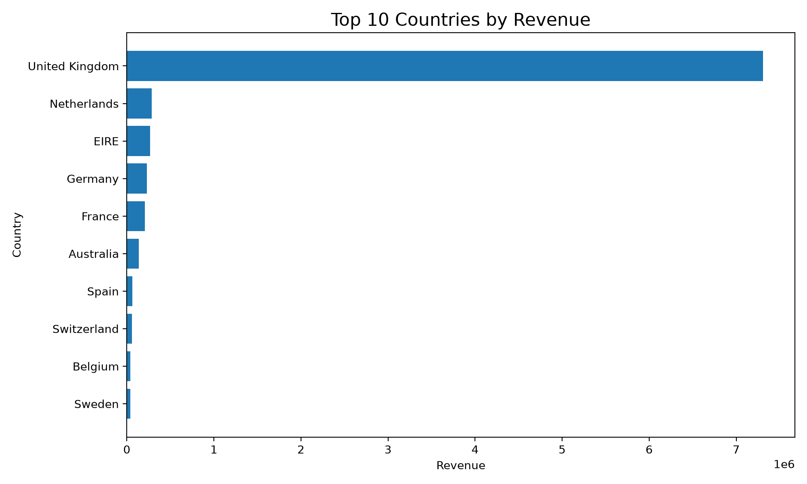
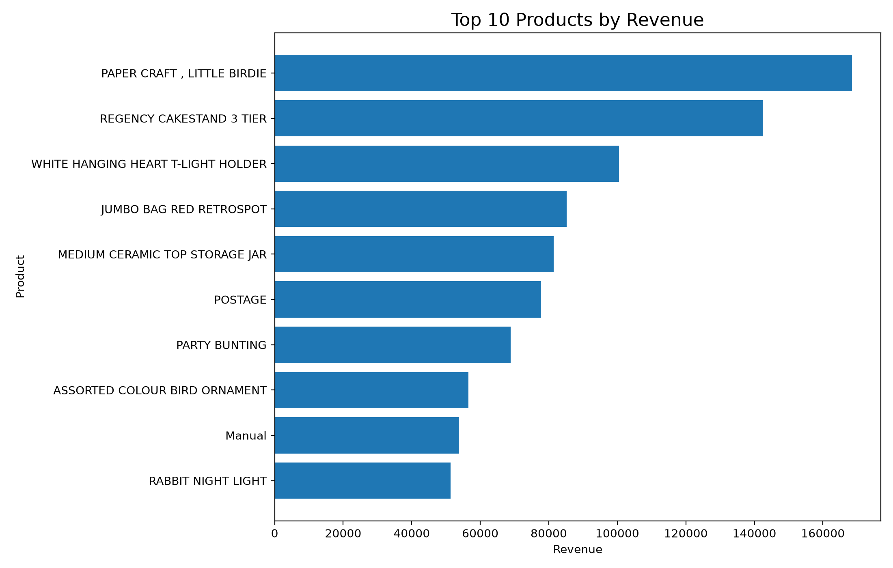
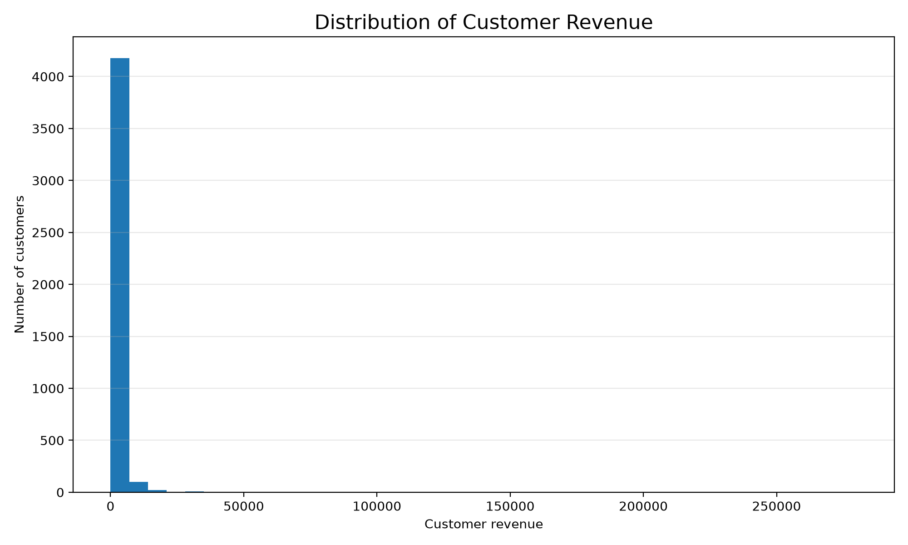

# E-Commerce Customer Behaviour Analytics Using Big Data

An end-to-end retail transaction analytics project using **Python, Apache Spark (PySpark), Pandas, and Matplotlib** to investigate sales performance, product demand, geographic revenue, and customer spending.

## Overview

This project analyzes the UCI Online Retail dataset to demonstrate a reproducible data analytics workflow: inspecting transaction data, measuring data quality, cleaning records, processing transactions with Apache Spark, calculating business KPIs, and visualizing results.

The project uses transaction records to study purchasing behaviour. It does not analyze website browsing, clickstream activity, or abandoned carts.

## Business Objectives

- Analyze monthly revenue trends.
- Identify top-performing products and countries by revenue.
- Examine customer spending and purchase frequency.
- Assess data quality and document cleaning decisions.
- Develop evidence-based business recommendations.
- Extend the analysis with RFM customer segmentation and a Power BI dashboard.

## Technology Stack

| Technology | Purpose |
|---|---|
| Python | Analysis scripts and workflow orchestration |
| Apache Spark (PySpark) | Distributed data processing and aggregation |
| Pandas | Dataset inspection and CSV export |
| Matplotlib | Business data visualization |
| Git and GitHub | Version control and project documentation |
| Power BI | Planned dashboard extension |

## Dataset

**UCI Online Retail Dataset**

Source: https://archive.ics.uci.edu/dataset/352/online+retail

The dataset contains historical transactions from a UK-based online retailer, covering December 2010 through December 2011. Fields include invoice identifiers, product codes and descriptions, quantities, invoice timestamps, unit prices, customer identifiers, and countries.

The original dataset contains **541,909 transaction rows and 8 columns**.

The raw dataset is not committed to this repository. Download it from the source above and place `Online Retail.xlsx` in `data/raw/`.

## Project Workflow

1. **Data inspection:** Examine the source file, column types, missing values, and dataset dimensions.
2. **Data conversion:** Export the Excel data to CSV for the Spark processing workflow.
3. **Data quality assessment:** Count missing customer identifiers, cancelled invoices, nonpositive quantities, nonpositive prices, and invalid invoice timestamps.
4. **Data cleaning:** Exclude records that do not meet the defined valid-sales criteria.
5. **Spark analytics:** Calculate revenue and aggregate results by month, country, product, and customer.
6. **Visualization:** Generate four Matplotlib charts from the processed analytical outputs.

## Key Results

Results from the current analysis run:

| Metric | Result |
|---|---:|
| Original transaction rows | 541,909 |
| Valid sales rows after filtering | 397,884 |
| Distinct customers in valid sales | 4,338 |
| Distinct invoices in valid sales | 18,532 |
| Total revenue | 8,911,407.90 |
| Rows with missing customer IDs | 135,080 |
| Cancelled invoice rows | 9,288 |
| Rows with nonpositive quantities | 10,624 |
| Rows with nonpositive unit prices | 2,517 |
| Rows with invalid invoice timestamps | 0 |

Revenue is calculated as **quantity × unit price** for records retained by the cleaning rules. The reported total is in the dataset's price units; the dataset does not provide a separate currency column.

The quality counts are separate checks and may overlap. They should not be added together to calculate the number of excluded rows.

### Initial Findings

- **November 2011** has the highest monthly revenue in the current results, at 1,161,817.38.
- The **United Kingdom** contributes the largest share of recorded revenue, at 7,308,391.55.
- `PAPER CRAFT , LITTLE BIRDIE` has the highest product-level revenue in the current aggregation. Its unusually large quantity and low invoice count warrant further investigation rather than an automatic assumption that the data is erroneous.
- Customer revenue varies substantially, suggesting an opportunity to investigate high-value customers and customer concentration.

December 2011 contains only a partial month of data in this dataset, so comparisons involving that month should be interpreted cautiously.

## Visualizations

The current pipeline generates these charts in `outputs/figures/`:



**Monthly revenue trend**



**Top 10 countries by revenue**



**Top 10 products by revenue**



**Distribution of customer revenue**

## Repository Structure

```text
ecommerce-customer-behaviour-analytics/
├── data/
│   ├── raw/                 # Downloaded source data (not tracked)
│   └── processed/           # Generated CSV outputs (not tracked)
├── outputs/
│   └── figures/             # Publishable charts
├── src/
│   ├── 01_inspect_data.py
│   ├── 02_clean_and_analyse.py
│   └── 03_create_visualisations.py
├── .gitignore
├── requirements.txt
└── README.md
```

## Setup and Reproduction

### 1. Prerequisites

Install Git, Anaconda or Miniconda, and a compatible Java runtime for the installed PySpark version. Configure Java so that `java -version` works in your terminal.

### 2. Clone the repository

```bash
git clone https://github.com/joysheeba-j/ecommerce-customer-behaviour-analytics.git
cd ecommerce-customer-behaviour-analytics
```

### 3. Create and activate the environment

```bash
conda create -n ecom-bigdata python=3.11 -y
conda activate ecom-bigdata
```

### 4. Install dependencies

```bash
python -m pip install -r requirements.txt
```

### 5. Download the dataset

Download the UCI Online Retail Excel file and place it at:

```text
data/raw/Online Retail.xlsx
```

Create the `data/raw/` directory if it does not exist.

### 6. Run the scripts in order

```bash
python src/01_inspect_data.py
python src/02_clean_and_analyse.py
python src/03_create_visualisations.py
```

The scripts create the CSV exports under `data/raw/` and `data/processed/`, and the charts under `outputs/figures/`. Generated datasets are excluded from Git by `.gitignore`.

## Current Scope and Future Work

**Implemented**
- Source-data inspection and CSV conversion.
- Data-quality reporting and valid-sales filtering.
- Revenue aggregation by month, country, product, and customer.
- KPI exports and four Matplotlib visualizations.

**Planned extensions**
- RFM (Recency, Frequency, Monetary) customer segmentation.
- A Power BI dashboard.
- Deeper analysis of repeat purchasing, customer concentration, and business recommendations.
- Additional validation of unusual product quantities and high-value transactions.

## Limitations

- The data represents completed transaction records, not website browsing or abandoned carts.
- Records without customer identifiers cannot contribute to customer-level analysis.
- Revenue results depend on the defined cleaning rules and should be interpreted in that context.
- The dataset covers a historical period and does not establish current retail behaviour.
- The current project uses local Spark execution; it demonstrates Spark transformations but does not benchmark performance on a distributed cluster.

## Author

**Joy Sheeba**

GitHub: https://github.com/joysheeba-j